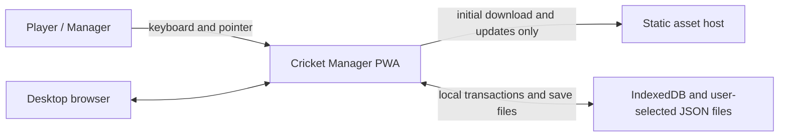
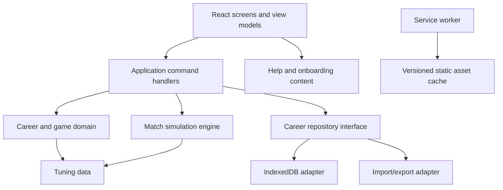
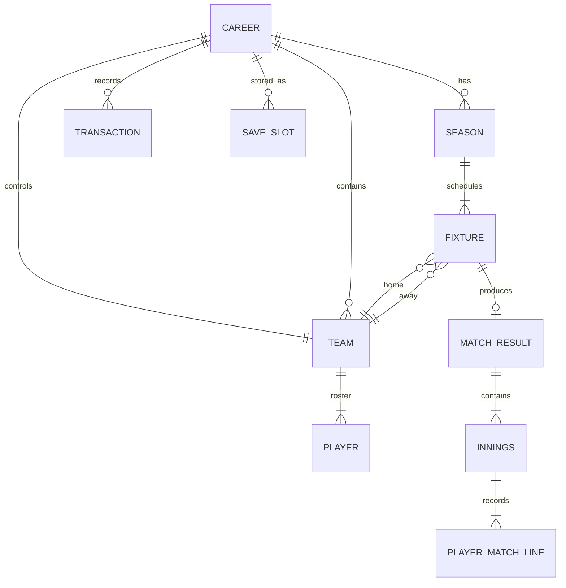
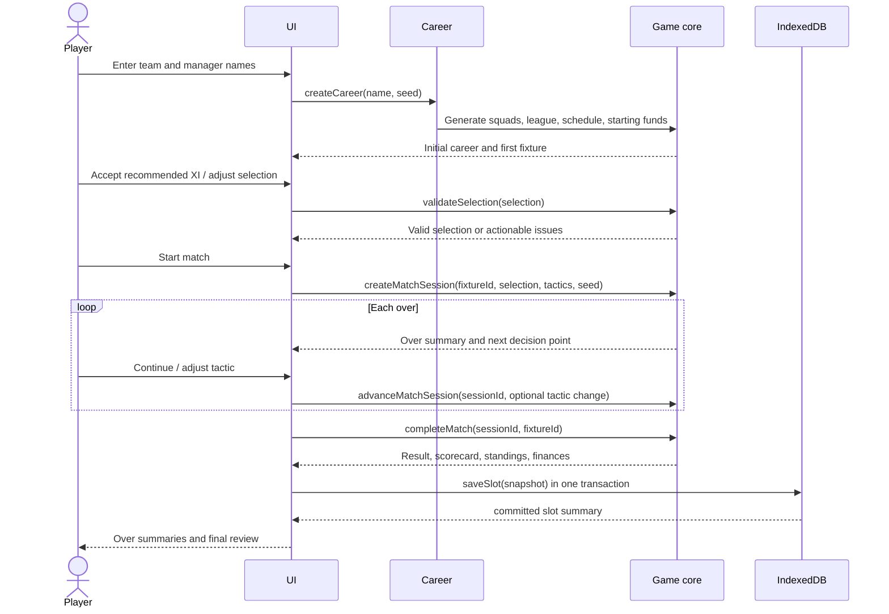

# Cricket Manager Architecture

## 1. Overview

Cricket Manager is an offline-capable, single-player cricket management game delivered as an installable web application. A React interface calls a framework-independent TypeScript game core for career, squad, training, fixture, match, finance, and progression rules. Career slots are stored in browser IndexedDB and can be exported to or imported from validated JSON files. The application has no server-side runtime, account system, networked gameplay, or telemetry.

**Goals:** complete the management loop; make cricket decisions consequential and explainable; support multi-season careers; guide a first-time player to a match; preserve fair, valid simulation; and keep extension points for future formats and competitions.

**Non-goals:** multiplayer, online play, multiple MVP formats, knockout competitions, visual match broadcast, complex contracts, modding, achievements, cloud saves, cross-device sync, localization, mobile-first layouts, and analytics.

**Architectural principles:**

- Keep all game rules in pure, framework-independent domain modules.
- Apply a player command as one validated state transition or leave the career unchanged.
- Persist complete versioned snapshots atomically; keep the previous valid slot until a replacement commits.
- Make simulation inputs and random seeds explicit so results can be explained and reproduced.
- Keep all tuning values in validated data files, not UI components or simulation control flow.

## 2. Requirements Traceability

`AC-01` through `AC-20` refer, in order, to the twenty acceptance criteria in `docs/PRD.md`.

| Requirement IDs | Components | Sections |
|---|---|---|
| FR-01, AC-01, AC-02 | Career, Competition, Persistence, UI | 7, 8, 9, 10, 12, 14, 15 |
| FR-02, AC-07, AC-08 | Squad, Finance, UI | 7, 8, 9, 10, 12, 14, 15 |
| FR-03, AC-09, AC-10, AC-17 | Development, Squad, UI | 7, 8, 9, 10, 12, 14, 15 |
| FR-04, AC-11, AC-12, AC-20 | Competition, Career, Persistence, UI | 7, 8, 9, 10, 12, 14, 15 |
| FR-05, AC-03, AC-04 | Selection, Squad, UI | 7, 8, 9, 10, 12, 14, 15 |
| FR-06, AC-05, AC-06 | Match Engine, Selection, UI | 7, 8, 9, 10, 12, 14, 15 |
| FR-07, AC-11 | Statistics, Competition, UI | 7, 8, 9, 10, 12, 14, 15 |
| FR-08, AC-07, AC-15 | Finance, Squad, Competition, UI | 7, 8, 9, 10, 12, 14, 15 |
| FR-09, AC-16 | AI Team, Selection, Match Engine | 7, 8, 9, 10, 14, 15 |
| FR-10, AC-12, AC-13, AC-14 | Persistence, Career, UI | 7, 8, 9, 10, 11, 12, 13, 14, 15 |
| FR-11, AC-01, AC-18 | UI, Guidance | 7, 10, 12, 14, 15 |
| NFR-01 | Match Engine, Competition, Statistics | 7, 8, 9, 10, 14, 15 |
| NFR-02 | Persistence, Career | 7, 8, 9, 10, 11, 13, 14, 15 |
| NFR-03 | UI, Match Engine | 7, 11, 12, 15 |
| NFR-04 | UI, Guidance | 7, 11, 12, 15 |
| NFR-05 | Match Engine, Tuning Data | 7, 8, 10, 14, 15 |
| NFR-06 | Game Core, Tuning Data | 5, 6, 7, 8, 14, 16 |
| NFR-07 | UI, Persistence, PWA | 7, 11, 12, 13, 15 |

## 3. Assumptions and Open Questions

### Assumptions

1. **Browser target:** support current evergreen desktop Chrome, Edge, and Firefox. This matches desktop/laptop scope and keeps browser-specific behavior bounded. If wrong, additional compatibility work is required.
2. **Offline meaning:** first launch/install requires downloading the static app once; after the service worker caches the app shell, gameplay and stored careers work without a network. A static host is needed only for initial distribution and updates. If fully offline first install is required, an installed desktop package would be needed.
3. **Storage scope:** career slots are local to the browser profile and device. Export/import is the supported portability and user-managed backup mechanism. Browser profile clearing can remove local slots; the app must explain this in save help.
4. **Competition defaults:** use eight teams total, a double round-robin limited-overs season, 20 overs per innings, eleven players, squad minimum 15 and maximum 25. These are MVP game defaults, not claims about a real-world competition.
5. **Progression cadence:** each fixture is one explicit time-advance milestone. A player may perform management actions before explicitly advancing to the next fixture; no calendar mutation occurs on merely opening a screen.
6. **Save recovery:** use a schema-versioned JSON document and retain the prior committed IndexedDB record until a new record has completed validation and transaction commit.

### Open Questions

1. **Exact balance values:** PRD requests tunable values but does not specify starting funds, fee formulas, training ranges, recovery duration, or points rules. Recommended default: define and present these in `src/game/data/default-rules.json`; use 100 starting budget units, squad size 18, 20 overs, 2 points for a win, 1 for a tie/no-result, and 0 for a loss. These are tuning defaults and must be playtested.
2. **Cloudflare Pages account and domain:** no deployment account is available in the repository. Recommended default: use a Cloudflare Pages static project when an owner account is configured; CI still produces and verifies `dist/` without deploying from untrusted branches.
3. **League tie-break order:** PRD requires consistent standings but does not define ordering. Recommended default: points, wins, net run rate, then team name; document net run rate as runs per over scored minus runs per over conceded, excluding incomplete innings from denominator overs only according to the configured rules data.

## 4. System Context and High-Level Architecture





For a fixture, the calendar screen requests the next fixture from the career command handler. The manager submits a proposed XI, wicket-keeper, batting order, and bowling preferences. Selection validates eligibility, role constraints, and exact team size before the command can start. On start, the engine receives the immutable fixture, selected teams, rules version, tactics, and match seed; it returns innings, events, scorecard, and result. The competition/statistics/finance handlers apply the result once using the fixture ID as the idempotency key, then a single IndexedDB transaction stores the completed career snapshot. The UI presents the over summaries and final scorecard.

## 5. Technology Stack

Versions below are exact pins to use when creating the project lockfile. Before implementation, resolve each to the latest stable release compatible with the listed runtime and record the exact patch version in `package.json` and `pnpm-lock.yaml`; do not use floating `latest` dependencies in committed manifests.

| Layer | Choice | Exact version policy | Rationale |
|---|---|---|---|
| Language | TypeScript | 7.0.2 | Typed domain contracts and browser app; avoid untyped game state. |
| UI | React + React DOM | 19.3.1 | Mature accessible component ecosystem. |
| Build/dev | Vite | 8.3.8 | Static output, fast local workflow, TypeScript support. |
| Package manager | pnpm | 10.24.0; pin via `packageManager` | Reproducible lockfile and workspace support. |
| Runtime | Node.js | 24.11.1 | Supported build environment; not required by players. |
| Local database | Native IndexedDB behind a typed repository | Browser API; no runtime library | Keeps offline persistence local and avoids a server/database dependency. |
| Routing | React Router | 8.5.1 | Screen routing with browser history and no server routes. |
| PWA | `vite-plugin-pwa` with Workbox | 2.0.0 | Generate manifest and precache static application shell. |
| Unit/component tests | Vitest 5.1.0, Testing Library React 16.3.0, jsdom 27.2.0 | Exact pins shown | Vite-native test runner and accessible UI behavior tests. |
| Browser tests | Playwright | 1.65.1 | Validate full offline, save, and career flows in real browsers. |
| Validation | Zod | 4.6.7 | Runtime validation for imported/save documents and tuning data. |
| Lint/format | ESLint 9.39.1, typescript-eslint 8.48.0, Prettier 3.6.2 | Exact pins shown | Static checks and consistent formatting. |
| Hosting | Cloudflare Pages static hosting | Managed service; no application server | Serves compiled files and supports HTTPS required for service workers. |
| CI | GitHub Actions | `actions/checkout` and `actions/setup-node` pinned to reviewed major/SHA | Install frozen lockfile, typecheck, lint, test, build, browser checks. |

**Rejected alternatives:** Next.js/server rendering adds server complexity to an offline single-user game; Electron adds packaging/runtime cost without a PRD need; cloud database/auth contradicts offline/no-account scope; Redux is unnecessary for state derived from one career command model; a third-party game engine is aimed at graphical real-time games rather than text/statistical simulation.

## 6. Repository Structure

```text
.
├── docs/                         # Product and architecture documents
│   ├── PRD.md                    # Product source of truth
│   └── ARCHITECTURE.md           # Build contracts and implementation plan
├── public/                       # Static icons and manifest assets
├── src/
│   ├── app/                      # Router, providers, application shell
│   ├── features/                 # Screen-level UI grouped by user workflow
│   │   ├── career/               # New/load career screens
│   │   ├── squad/                # Squad, free agents, finances
│   │   ├── training/             # Training configuration
│   │   ├── calendar/             # Fixtures and standings
│   │   ├── selection/            # XI and tactics
│   │   ├── match/                # Match presentation and scorecard
│   │   └── help/                 # Walkthrough and glossary
│   ├── game/                     # Framework-independent domain and simulation
│   │   ├── career/                # Career commands and state transitions
│   │   ├── squad/                 # Player, roster, transfer rules
│   │   ├── development/           # Training, fitness, form, injury, retirement
│   │   ├── competition/           # Fixtures, results, standings, seasons
│   │   ├── selection/             # Legal XI and recommendations
│   │   ├── match/                 # Match engine and scorecard calculations
│   │   ├── ai/                    # Computer-team generation and selection
│   │   ├── finance/               # Balance and transaction rules
│   │   ├── statistics/            # Cumulative player/team statistics
│   │   └── data/                  # Versioned default tuning data
│   ├── persistence/              # IndexedDB, save schema, migrations, file I/O
│   ├── shared/                   # Pure common types and UI primitives
│   ├── styles/                   # Tokens, global styles, responsive layout
│   └── main.tsx                  # Browser entry point
├── tests/                        # Cross-component and browser tests
├── index.html                    # PWA document shell
├── package.json                  # Scripts and exact dependency pins
├── pnpm-lock.yaml                # Reproducible dependency graph
├── vite.config.ts                # Build and PWA configuration
└── .github/workflows/ci.yml      # CI workflow
```

Use kebab-case file names, PascalCase React components and types, camelCase functions/variables, and stable prefixed IDs for domain records. Database object stores use singular lowerCamelCase names. `src/game` must not import from `src/features` or `src/app`. Feature agents own only their feature subtree. Game component owners own their matching `src/game/<component>` subtree. `src/shared`, package manifests, root configuration, persistence schemas, and this architecture document are shared files: change them only through a contract-change task that updates this document and its dependent tasks in the same review.

## 7. Components and Modules

| Component | Responsibility; owns | Public interface | Depends on | Must not | Requirements |
|---|---|---|---|---|---|
| App/UI | Render accessible screens and translate user actions into commands; `src/app`, `src/features`, `src/shared`, `src/styles` | Router screens and typed application hooks | Application services, Guidance | Implement game rules or access IndexedDB directly | FR-01–FR-11, NFR-03, NFR-04, NFR-07 |
| Career | Create/load careers and orchestrate validated state transitions; `src/game/career` | `createCareer`, `applyCareerCommand`, `validateCareer` | Squad, Competition, Finance, Development, Statistics | Persist directly or depend on UI | FR-01, FR-04, FR-10, NFR-02 |
| Squad | Player/roster operations and eligibility attributes; `src/game/squad` | `signPlayer`, `releasePlayer`, `validateRoster` | Finance | Bypass command validation or mutate state in place | FR-02, FR-05, FR-09 |
| Development | Apply training, weekly aging/form/fitness, injury recovery, retirement; `src/game/development` | `advanceDevelopment` | Squad, tuning data | Advance calendar without explicit career command | FR-03, FR-04 |
| Competition | Generate fixtures, record results, advance season, compute standings; `src/game/competition` | `createSchedule`, `recordFixtureResult`, `startNextSeason`, `calculateStandings` | Statistics, Finance, AI Team | Simulate match details or duplicate completed fixture results | FR-01, FR-04, FR-07, FR-08 |
| Selection | Validate/recommend XI, keeper, batting order, bowling preferences; `src/game/selection` | `recommendSelection`, `validateSelection` | Squad, tuning data | Permit unavailable players or silently repair a user XI | FR-05, FR-09 |
| Match Engine | Simulate innings/events and derive scorecards; `src/game/match` | `createMatchSession`, `simulateNextOver`, `finalizeMatch` | Selection types, tuning data | Read/write career storage, call UI, or use ambient randomness | FR-06, NFR-01, NFR-05, NFR-06 |
| AI Team | Maintain comparable AI squads and create legal opponent selections; `src/game/ai` | `createLeagueTeams`, `selectAiTeam`, `turnoverAiSquads` | Squad, Selection, tuning data | Use player-only commands or create an illegal XI | FR-01, FR-09 |
| Finance | Validate and record budget transactions; `src/game/finance` | `applyTransaction`, `canAfford` | None | Allow negative balance or directly update UI | FR-02, FR-08 |
| Statistics | Derive cumulative player/team statistics from completed results; `src/game/statistics` | `updateStatistics`, `rebuildStatistics` | Match result types | Treat a fixture as completed more than once | FR-07, NFR-01 |
| Persistence | Atomic local slot storage, schema validation/migrations, export/import; `src/persistence` | `listSlots`, `loadSlot`, `saveSlot`, `exportSlot`, `importSlot`, `deleteSlot` | Domain schemas | Apply gameplay rules or expose raw DB to UI | FR-01, FR-10, NFR-02, NFR-07 |
| Guidance | Walkthrough state, contextual help, glossary definitions; `src/features/help` | `getHelpForScreen`, `completeWalkthroughStep` | UI | Change career state | FR-11 |

Allowed dependency direction is UI → application command handlers → game domain → tuning data. Application handlers may call Persistence after domain validation. Persistence may import domain schema types and validation but domain code may not import Persistence. Match Engine is a leaf with respect to career state. This graph is acyclic.

## 8. Data Model



All IDs are UUID strings. All dates are ISO-8601 UTC date-only values (`YYYY-MM-DD`); all money uses integer budget units; overs and balls are integer balls internally and formatted for display. Do not use floating point for funds or standings arithmetic.

| Entity | Fields and constraints | Indexes/relationships/lifecycle |
|---|---|---|
| Career | `id`, `schemaVersion`, `rulesVersion`, `managerName`, `teamId`, `currentSeasonId`, `currentFixtureIndex`, `createdAt`, `updatedAt`, `walkthroughCompleted` | One career per slot; created by career setup, changed only through commands, deleted with slot. |
| Team | `id`, `name`, `isPlayerControlled`, `funds`, `rosterPlayerIds`, `wins`, `losses`, `ties`, `noResults`, `points`, `runsScored`, `ballsFaced`, `runsConceded`, `ballsBowled` | Unique team ID per career; player-controlled team references one Career. |
| Player | `id`, `name`, `role` (`batter|bowler|allRounder|wicketKeeper`), `batting`, `bowling`, `fielding`, `age`, `form`, `fitness`, `status` (`available|injured|suspended|retired`), `injuryRecoveryDays`, `trainingFocus`, `teamId|null`, `transferCost` | Indexed by `teamId`, `status`, `role`; released players become free agents, retired players cannot be signed or selected. |
| Season | `id`, `number`, `startDate`, `status` (`active|complete`), `fixtureIds`, `standings`, `completedAt|null` | Belongs to Career; only one active season at a time. |
| Fixture | `id`, `seasonId`, `round`, `date`, `homeTeamId`, `awayTeamId`, `formatId`, `status` (`upcoming|inProgress|complete`), `resultId|null` | Unique `(seasonId, round, homeTeamId, awayTeamId)`; result ID unique and applied once. |
| MatchResult | `id`, `fixtureId`, `seed`, `rulesVersion`, `winnerTeamId|null`, `outcome`, `summary`, `innings`, `completedAt` | Unique `fixtureId`; immutable after completion. |
| Innings | `teamId`, `runs`, `wickets`, `balls`, `target|null`, `fallOfWickets`, `battingLines`, `bowlingLines`, `overSummaries` | Embedded in MatchResult; wickets 0–10, runs/balls nonnegative. |
| PlayerMatchLine | `playerId`, `runs`, `ballsFaced`, `fours`, `sixes`, `wickets`, `runsConceded`, `ballsBowled`, `maidens`, `catches`, `runOuts` | Embedded in innings; counts nonnegative and internally consistent. |
| Transaction | `id`, `careerId`, `teamId`, `fixtureId|null`, `kind`, `amount`, `balanceAfter`, `createdAt`, `description` | Unique transaction ID; amount signed integer; balanceAfter >= 0. |
| SaveSlot | `slotId` (1–10), `careerId`, `schemaVersion`, `savedAt`, `summary`, `payload`, `checksum` | IndexedDB record keyed by slotId; summary includes manager, team, season number, date, and funds. |

Career snapshot validation checks references, unique IDs, nonnegative balances, legal roster sizes, fixture/result consistency, and standings reproducibility. Migrations are pure functions `vN -> vN+1`; retain old data until migrated data validates and is committed. No personal data beyond optional manager/team/player display names is collected. Deleting a slot deletes its complete stored career record. Seed data is generated deterministically from a career seed; no network seed download is allowed.

## 9. API and Interface Contracts

There is no HTTP API. The following application commands are the public interface between UI and game services. Commands return `Result<T, GameError>` where errors contain `code`, `message`, and optional `details`; no command partially mutates caller state. Reads return `Result<T, GameError>` as well.

```ts
type GameError = { code: string; message: string; details?: Record<string, string | number | boolean> };
type Result<T> = { ok: true; value: T } | { ok: false; error: GameError };
type CommandResponse<T> = { state: Career; value: T };
```

All state-changing commands accept `{ careerId: string, expectedUpdatedAt: string, commandId: string }` in a `meta` field. `expectedUpdatedAt` prevents overwriting a newer in-memory state; `commandId` is deduplicated within the same committed snapshot. Reads need no auth because the application has a single local player. There is no pagination at MVP league sizes; list functions return complete lists sorted by the ordering defined below.

| Command | Request → response | Errors and idempotency |
|---|---|---|
| `createCareer` | `{ teamName, managerName?, seed }` → `{ career, slotSuggestions }` | `INVALID_NAME`; deterministic seed yields same initial teams. Does not persist until `saveSlot`. |
| `listSlots` | `{}` → `{ slots: SaveSlotSummary[] }` | Storage errors `STORAGE_UNAVAILABLE`. Sorted by slot ascending. |
| `loadSlot` | `{ slotId }` → `{ career }` | `SLOT_NOT_FOUND`, `SAVE_CORRUPT`, `SAVE_VERSION_UNSUPPORTED`; no slot is modified. |
| `saveSlot` | `{ meta, slotId, career }` → `{ slot: SaveSlotSummary }` | `SLOT_INVALID`, `CONFLICT`, `STORAGE_QUOTA`, `STORAGE_UNAVAILABLE`; retry with same `commandId` returns prior committed result. Atomic transaction. |
| `deleteSlot` | `{ meta, slotId }` → `{ deleted: true }` | `SLOT_NOT_FOUND`, `CONFLICT`; repeated command ID is idempotent. |
| `signPlayer` / `releasePlayer` | `{ meta, playerId }` → `{ state, transaction }` | `PLAYER_NOT_FOUND`, `SQUAD_MINIMUM`, `SQUAD_MAXIMUM`, `INSUFFICIENT_FUNDS`, `PLAYER_RETIRED`; validate all conditions before state change. |
| `setTraining` | `{ meta, teamFocus, playerFocuses: Record<playerId, focus> }` → `{ state }` | `PLAYER_NOT_FOUND`, `INVALID_FOCUS`; replace training assignment atomically. |
| `advanceToNextFixture` | `{ meta }` → `{ state, fixture, notifications }` | `NO_UPCOMING_FIXTURE`, `SELECTION_REQUIRED`, `SEASON_COMPLETE`; explicit command advances exactly one scheduled interval and applies development once. |
| `recommendSelection` | `{ careerId, fixtureId, teamId }` → `{ selection }` | `FIXTURE_NOT_FOUND`; deterministic recommendation given current state. |
| `validateSelection` | `{ fixtureId, teamId, selection }` → `{ valid, issues[] }` | Returns all validation issues; no mutation. XI exactly 11, one keeper, valid unique player IDs, eligible players, batting order 1–11, bowling preference IDs from XI. |
| `createMatchSession` | `{ careerId, fixtureId, playerSelection, initialTactics, seed }` → `{ sessionId, nextDecision: "overBoundary" }` | `FIXTURE_NOT_FOUND`, `FIXTURE_COMPLETE`, `INVALID_SELECTION`; creates an in-memory worker session and does not mutate career state. |
| `advanceMatchSession` | `{ sessionId, tacticChange?: { battingAggression?, bowlingPlan?, bowlerId? } }` → `{ overSummary, nextDecision, provisionalScore }` | `SESSION_NOT_FOUND`, `INVALID_TACTIC`, `SIMULATION_INVARIANT`; advances exactly one over; tactics accepted only at the over boundary. |
| `completeMatch` | `{ meta, sessionId, fixtureId }` → `{ state, result }` | `SESSION_NOT_FOUND`, `FIXTURE_COMPLETE`, `SIMULATION_INVARIANT`; validates final scorecard and applies result once using fixture ID. |
| `getStandings` / `getHistory` | `{ careerId, seasonId? }` → `{ standings }` / `{ results }` | `SEASON_NOT_FOUND`; standings sorted by points, wins, net run rate, team name; history newest first. |
| `startNextSeason` | `{ meta }` → `{ state, season }` | `SEASON_NOT_COMPLETE`; applies AI turnover once and creates next full schedule. |
| `exportSlot` | `{ slotId }` → `Blob` of `application/json` | `SLOT_NOT_FOUND`, `SAVE_CORRUPT`; contains format marker, version, checksum, and career snapshot. |
| `importSlot` | `{ file: File, targetSlotId }` → `{ slot }` | `FILE_TOO_LARGE` (>10 MiB), `INVALID_FILE`, `SAVE_CORRUPT`, `SAVE_VERSION_UNSUPPORTED`, `SLOT_INVALID`; validates before atomic replacement. |

`Selection` schema: `{ wicketKeeperId: string, battingOrder: string[11], bowlingOrder: string[], captainId: string }`. `Tactics` schema: `{ battingAggression: "cautious"|"balanced"|"aggressive", bowlingPlan: "control"|"balanced"|"attack" }`. Match presentation advances one over per worker request and pauses at each boundary; tactics may change there only. A session is ephemeral until its result is complete; closing the page during a match may lose progress since the last completed-match save, as permitted by NFR-02. MatchResult stores every over summary and wicket event, enough to render over-by-over text and complete batting/bowling figures.

## 10. Key Flows

### New career to match result



1. Generate eight comparable teams and a full double round-robin schedule from the career seed. If generation fails invariants, return `CAREER_GENERATION_FAILED`; do not create a partial career.
2. Recommendation always uses eleven unique eligible players including a keeper. If the player squad cannot form a legal XI, career setup fails visibly and uses valid generated default roster data rather than continuing in an unplayable state.
3. Reject invalid selection before simulation with specific player/constraint messages. Do not advance time or spend funds.
4. Simulate one over per Web Worker request and pause for the player's pace/tactic decision. Worker failure can restart the match session with the same seed; no partial match result is committed.
5. Apply match result, standings, statistics, and finance rewards as one domain transition. Fixture result uniqueness and `commandId` prevent double application.
6. Persist completed state atomically; on quota/storage errors retain the previous committed slot and show an export/retry action.

### Save/load and import recovery

```mermaid
sequenceDiagram
  actor Player
  participant UI
  participant Persistence
  participant IDB as IndexedDB
  Player->>UI: Choose save slot
  UI->>Persistence: loadSlot(slotId)
  Persistence->>IDB: Read record in readonly transaction
  IDB-->>Persistence: Versioned payload
  Persistence->>Persistence: Check checksum, validate, migrate in memory
  alt Valid and supported
    Persistence-->>UI: Career snapshot
  else Invalid or unsupported
    Persistence-->>UI: Typed error; original record untouched
    UI-->>Player: Explain issue and return to slot list
  end
```

A missing/corrupt/unsupported slot never crashes the app or changes other slots. Imports are capped at 10 MiB, parsed as data only, schema-validated, checksum-checked, then committed to the chosen slot in one transaction; unsupported future versions are rejected without overwrite.

## 11. Cross-Cutting Concerns

**Authentication/authorization:** not applicable; there is one local player and no remote service. Any local app user can access local slots.

**Configuration:** no runtime secrets or environment variables. Build-time optional `VITE_PUBLIC_BASE_PATH` (string, optional, default `/`) configures static-host subpath; `VITE_APP_VERSION` (string, required in CI, generated from package version) is displayed in diagnostics. No configuration may contain credentials.

**Errors/logging:** display `GameError.message` and recovery guidance. Log structured `{ time, level, code, screen, correlationId }` to console in development only; production logs only actionable client errors and never persist them. Never log save contents, names, imported file data, or player career payloads.

**Validation:** validate UI inputs at entry for usability and again in game command handlers for correctness. Validate persisted/imported data at trust boundaries with Zod schemas and domain invariants. Use integer arithmetic for counters, funds, balls, and points.

**Security:** serve only HTTPS; use static assets with a restrictive CSP (`default-src 'self'; script-src 'self'; connect-src 'self'; object-src 'none'; base-uri 'self'; frame-ancestors 'none'`). Treat import files as untrusted JSON, reject oversized/unknown schemas, never evaluate imported content, and render user names as text. No third-party runtime requests.

**Performance:** squad/calendar/standings screens must update within 100 ms for the PRD maximum league and roster sizes on a typical desktop. Simulate a full match in a Web Worker; UI event loop input response target under 100 ms at maximum presentation speed. Persist a snapshot after each completed match and season; IndexedDB writes use strict durability when supported and fall back to default transaction durability otherwise.

**Observability:** no telemetry. Provide in-app build version, last successful save timestamp, IndexedDB/storage availability status, and service-worker update prompt. Health is a local startup check that validates tuning data and opens the IndexedDB database; failures show a recoverable diagnostic screen.

**Accessibility/i18n:** single language, English. Support keyboard-only navigation, visible focus, semantic labels/headings, 4.5:1 normal-text contrast, reduced-motion preference, and no timed decisions. Use readable text and contextual definitions; do not encode meaning by color alone.

## 12. Frontend Architecture

Routes: `/` redirects to `/careers`; `/careers` lists/creates slots; `/career/:careerId` dashboard; child routes `/squad`, `/training`, `/calendar`, `/selection/:fixtureId`, `/match/:fixtureId`, `/review/:fixtureId`, `/standings`, `/help`. Route guards return to career selection if no career is loaded; they do not mutate saves.

Use React Router for navigation and a small `CareerSession` provider for the active immutable snapshot, pending command status, and typed errors. Do not maintain a second editable copy of authoritative game state. Forms hold drafts locally; submit through commands, then replace the session snapshot only on success. IndexedDB access is confined to application services.

Screens and key components:

- Career list/create: slot cards, summary, create form, import/export, corrupt-slot explanation.
- Dashboard/calendar: funds banner, next fixture, training summary, notifications, fixture list, standings link.
- Squad: roster table, player detail, free-agent comparison, sign/release confirmation and transaction feedback.
- Training: team focus selector, player overrides, expected development explanation.
- Selection: availability roster, recommended XI action, 11-position batting-order editor, keeper designation, bowling sequence editor, validation summary.
- Match: innings/over timeline, score summary, pause/pace controls, over-boundary tactic controls, skip-to-result action.
- Review/standings: scorecard, fall of wickets, turning-point explanation, team/player statistics, prior results.
- Help: first-time guided steps, contextual panel on each screen, searchable glossary.

Use semantic HTML and CSS modules or feature-scoped styles. Keep screen components presentational; place command orchestration in feature hooks/application services and domain rules in `src/game`.

## 13. Infrastructure and Deployment

**Local:** Node.js 24 LTS and pnpm pinned by `packageManager`; `pnpm install --frozen-lockfile`, then `pnpm dev`. No credentials or backend required.

**Environments:** local development uses Vite and browser IndexedDB; pull-request CI builds/tests without deployment; production is static `dist/` hosted on Cloudflare Pages over HTTPS. No staging backend exists; a preview deployment can use a separate Pages preview URL and isolated browser profile.

**CI stages:** checkout; setup pinned Node and pnpm; frozen install; formatting check; ESLint; TypeScript check; unit/component tests; production build; Playwright Chromium smoke and offline tests. Deploy production only from protected `main` after all stages pass.

**Deployment:** publish `dist/`, configure SPA fallback to `/index.html`, set cache headers so fingerprinted assets are immutable and `index.html`/service worker revalidate, verify HTTPS and installability. Service worker uses versioned precache and activates updated shell only after user consent when a career is active.

**Rollback:** redeploy prior immutable static build. Since game snapshots are stored locally and schema changes use explicit backward-compatible migrations, application rollback must continue reading the previous schema version; never auto-upgrade stored data destructively. Keep the previous app-shell cache until the new shell passes startup validation.

**Infrastructure as code:** keep build, PWA, CI, and deployment configuration in repository files; Cloudflare project/domain binding is documented setup rather than a required backend resource. No secrets are required for public static build.

## 14. Implementation Plan for AI Agents

### Build phases

1. **Foundation:** project shell, types, rules schema, repository contracts, accessible design tokens. Done when a static app builds, typechecks, and starts locally.
2. **Game core:** career generation, squad/finance, schedule/standings, development, selection, deterministic match engine, statistics, AI. Done when domain acceptance tests pass without UI or browser dependencies.
3. **Persistence:** atomic IndexedDB slots, migrations, recovery, import/export, autosave milestones. Done when roundtrip, corruption, quota, and replacement behavior are verified.
4. **Player workflows:** screens, guidance, match presentation and command integration. Done when first career to result and full-season flows work by keyboard.
5. **Offline release:** PWA, CI, deployment configuration, full acceptance suite and rules/balance documentation. Done when production build installs, operates offline after first load, and completes a season.

### Task breakdown

| ID | Description and owned files | Depends on | Spec | Acceptance criteria |
|---|---|---|---|---|
| T01 | Scaffold package/scripts/CI: root configs, `package.json`, lockfile, `vite.config.ts`, `.github/workflows/ci.yml` | — | 5, 6, 13, 16 | Reproducible install; local app and CI checks run. |
| T02 | Define shared schemas/errors/IDs: `src/shared`, `src/game/types.ts`, `src/game/data/*` | T01 | 8, 9, 16 | All core entities and rules validate; no UI imports in game types. |
| T03 | Career, squad, finance, development: corresponding `src/game/*` modules | T02 | 7–9 | Commands are atomic; squad/funds/injury/training/retirement rules covered. |
| T04 | Competition, AI, selection: `src/game/competition`, `src/game/ai`, `src/game/selection` | T02, T03 | 7–10 | Full legal schedule and recommendations; standings derive from results. |
| T05 | Match engine/statistics: `src/game/match`, `src/game/statistics` | T02, T04 | 7–10 | Seeded over-step simulation terminates; scorecard invariants and statistics hold. |
| T06 | IndexedDB/save schemas/import-export: `src/persistence` | T02 | 8–11 | Atomic slots, migration, checksum and corruption handling work. |
| T07 | App shell and career screens: `src/app`, `src/features/career` | T01, T02, T06 | 12 | Create/list/load/delete slots; recoverable errors; keyboard flow. |
| T08 | Squad/training/calendar/standings UI: respective `src/features/*` | T03, T04, T07 | 12 | Commands and validation visible; no direct database/domain mutation. |
| T09 | Selection/match/review UI: `src/features/selection`, `src/features/match`, `src/features/review` | T04, T05, T07 | 10, 12 | Playable match, pause/pace, over-boundary tactics, full review. |
| T10 | Guidance and help: `src/features/help` and screen integrations | T07–T09 | 12 | Walkthrough reaches match; each management screen exposes contextual definitions. |
| T11 | PWA, release checks, user rules/help docs: `public`, `src`, `docs` except PRD | T01, T06–T10 | 11, 13, 15 | Offline after first load; acceptance suite and full-season demonstration pass. |

### Parallelization map

T01 lands first. T02 follows and is the shared-contract foundation. After T02, T03, T06, and initial shell T07 can proceed concurrently if T07 consumes only frozen interfaces. T04 follows T03; T05 follows T04. T08 follows T03/T04; T09 follows T05. T10 can proceed alongside screen implementation after route/screen names are fixed. T11 integrates all completed tasks. Do not have parallel tasks edit `src/shared`, `src/game/types.ts`, package manifests, persistence schemas, or route registry; contract updates require the protocol below.

**Shared-file protocol:** submit a contract-change proposal naming the affected schema/function, update Section 8 or 9 and the relevant task acceptance criteria in the same change, then notify all dependent task owners. Merge the contract before dependent implementation. No agent may silently widen a public type or command.

**Integration points:** T03–T05 integrate through pure domain commands and fixtures; T06 integrates through the CareerRepository interface; T07–T10 integrate through application command services. Verify each boundary with contract tests, then run browser flows for creation → selection → result → reload → next season.

## 15. Testing Strategy

Use Vitest for domain, persistence adapter, and component tests; Testing Library for keyboard and accessible UI behavior; Playwright for real-browser career and offline workflows. Name tests `*.test.ts`/`*.test.tsx`; end-to-end specs live in `tests/e2e/*.spec.ts`.

- **Game core:** property/table-driven checks for squad limits, budget non-negativity, legal XI, innings/wicket/over invariants, scorecard totals, standings arithmetic, result idempotency, and season progression. Run automated seeded seasons across a fixed seed set and report win-rate spread and invalid-result count.
- **Persistence:** save/load roundtrip, interrupted transaction leaves old slot, corrupt/missing/future schema recovery, migration, checksum rejection, import size limit, export/import equality, and one slot failure does not affect others.
- **UI:** keyboard-only create-career-to-match path, contextual help, actionable validation messages, no accidental time advance, and responsive desktop/laptop layouts.
- **End-to-end:** AC-01 first match, AC-13 save restoration, AC-14 corrupt file recovery, AC-19 offline operation after load, and AC-20 full season completion.

Every task must include tests for its owned behavior and pass typecheck/lint. A release candidate must satisfy all twenty acceptance criteria and produce zero invalid results across at least 10,000 seeded fixtures; balance thresholds are established from the first automated season baseline and recorded in the evaluation report.

## 16. Coding Standards and Agent Rules

- Use strict TypeScript; avoid `any`, unchecked casts, ambient mutable state, and floating-point money/count arithmetic.
- Keep game functions pure where possible; inject seeds, clocks, and repositories rather than reading globals.
- Return typed `Result` errors for expected blocked actions; reserve thrown exceptions for programming faults and catch them at application boundaries.
- Add dependencies only when they implement a named architecture capability; update exact pins and lockfile together.
- Keep UI components focused on rendering and interaction; do not put game rules in React components.
- Do not add root directories, network services, telemetry, or user accounts without updating this document and the PRD traceability.
- Do not change public commands, schemas, persisted field names, or tuning semantics without updating Sections 8/9 and dependent tasks in the same change.
- Use descriptive tests for every acceptance behavior and keep fixtures deterministic.
- Format with Prettier, lint with ESLint, and require typecheck before integration.
- When a detail is ambiguous, follow the numbered assumption/default, record any new decision in Section 18, and continue; raise an Open Question only if implementation would otherwise risk irreversible save incompatibility.

## 17. Risks and Mitigations

| Risk | Likelihood | Impact | Mitigation | Fallback |
|---|---|---|---|---|
| Browser storage is cleared or quota is exhausted | Medium | High | Atomic snapshots, storage status, visible last-save time, export/import, quota recovery message | Restore from exported save; retain previous committed slot on failed write. |
| Simulation produces implausible or exploitable tactics | High | High | Seeded season simulations, logged result explanations, tuning data, balance report | Adjust rules data without changing engine interfaces. |
| Large match simulation blocks UI | Medium | Medium | Run simulation in Web Worker and stream over summaries | Fall back to chunked asynchronous simulation if worker unsupported. |
| Service-worker update disrupts active career | Low | High | Prompt update while a career is active; versioned immutable assets and schema migrations | Continue current shell until safe reload. |
| Rules/tuning data invalidates career assumptions | Medium | High | Store rules version with career and validate compatibility on load | Keep prior rules bundle or provide explicit migration; never silently reinterpret a match. |
| Scope expands to other formats or online play | Medium | Medium | Keep format ID and engine interfaces explicit; exclude new formats/network from MVP | Add new format modules in a later architecture revision. |

## 18. Decision Log

1. **Local-first PWA:** browser app with service-worker caching and IndexedDB. Alternatives: Electron or hosted web service. Chosen to meet desktop/web, offline, no-account scope with the smallest runtime surface. Consequence: first install needs a network and saves belong to a browser profile.
2. **Portable save files:** JSON export/import alongside local slots. Alternative: browser-only slots. Chosen to provide user-controlled backup and device transfer without cloud accounts. Consequence: import validation and format migrations are required.
3. **Pure TypeScript game core:** simulation and rules independent of React. Alternative: rules embedded in UI or game engine framework. Chosen for deterministic tests, explainability, and future formats. Consequence: domain contracts must remain stable and explicit.
4. **Static deployment:** Cloudflare Pages by default. Alternative: app server/API. Chosen because MVP has no remote state or user identity. Consequence: no server-side save recovery or telemetry.
5. **Seeded, worker-based simulation:** explicit seed and Web Worker execution. Alternative: ambient random and main-thread simulation. Chosen for reproducibility and responsive controls. Consequence: all randomness must be passed through the match input.
